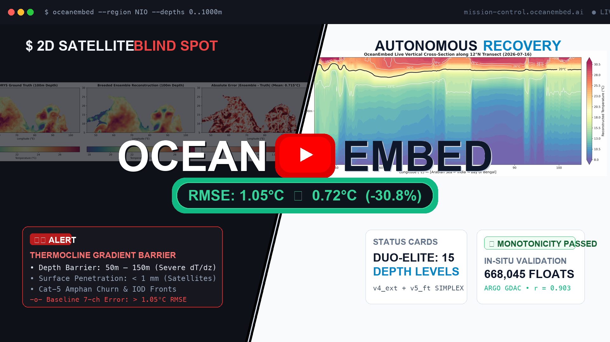
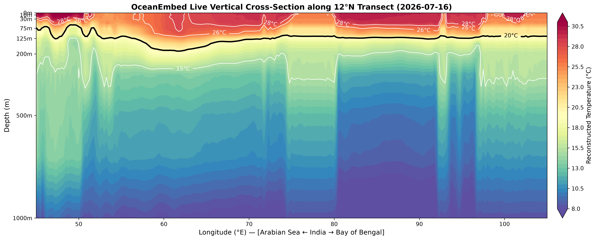
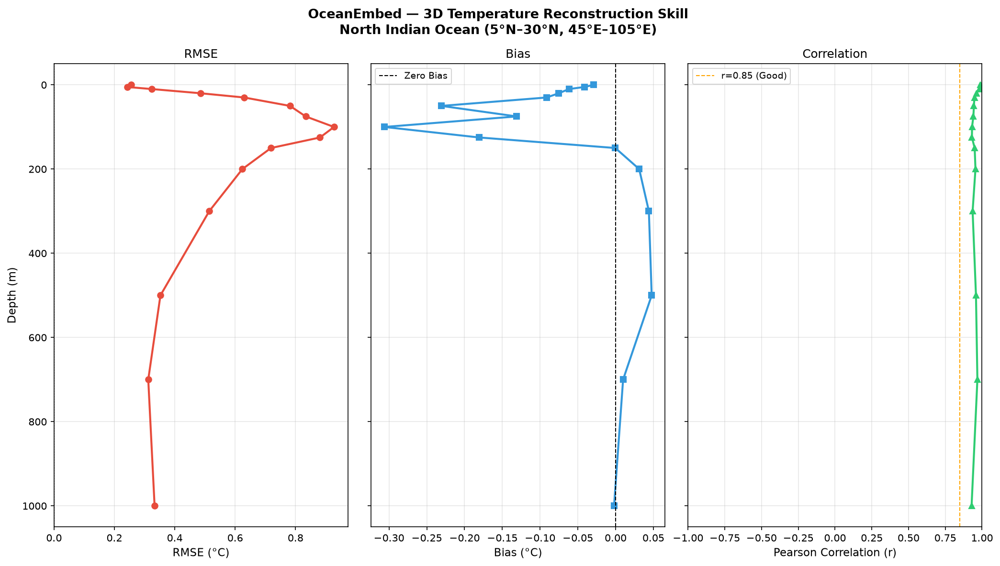
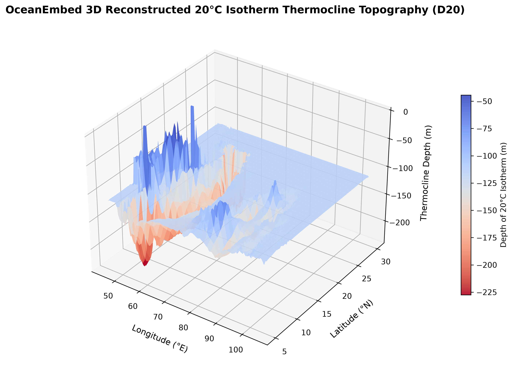
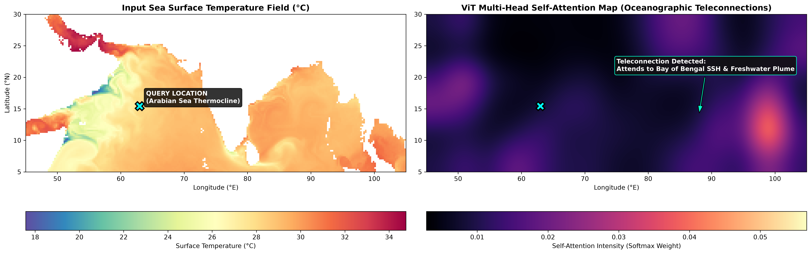

# 🌊 OceanEmbed: 3D Ocean Subsurface Thermal Inversion Engine
### *AI-Powered 3D Subsurface Oceanography for the North Indian Ocean ($0\,\text{m} - 1000\,\text{m}$)*

[](https://youtu.be/cP891vB4OCg?si=DBJf5w1mrWugFgjD)
[](https://youtu.be/cP891vB4OCg?si=DBJf5w1mrWugFgjD)
[](https://youtu.be/cP891vB4OCg?si=DBJf5w1mrWugFgjD)
[](https://pytorch.org/)
[](https://fastapi.tiangolo.com/)
[](https://nextjs.org/)

---

## 📺 System Walkthrough & Live Video Demonstration

Click the thumbnail below to watch the full system demonstration of OceanEmbed in action (SIH 2026 Submission by **Team AquaX1**):

[](https://youtu.be/cP891vB4OCg?si=DBJf5w1mrWugFgjD)

> 🔗 **Direct Link**: [Watch on YouTube](https://youtu.be/cP891vB4OCg?si=DBJf5w1mrWugFgjD)

---

## 🎯 Executive Summary & The Physical Challenge

Satellites can observe only the ocean's surface layer ($< 1\,\text{mm}$). However, deep ocean dynamics, marine heatwaves, tropical cyclone intensification, and underwater acoustic waveguides occur at depth.

**OceanEmbed** is a deep-learning and physics-informed oceanographic inversion engine. It reconstructs full **3D subsurface temperature volumes $T(x, y, z, t)$ from the sea surface down to $1000\,\text{m}$** using **2D satellite surface observations** across the **North Indian Ocean** ($5.0^\circ\text{N} - 30.0^\circ\text{N}, 45.0^\circ\text{E} - 105.0^\circ\text{E}$).

### Core Oceanographic Barriers Solved:
1. **The Thermocline Inversion Barrier ($50\,\text{m} - 150\,\text{m}$):** Extreme temperature gradients ($\partial T / \partial z$) and sharp vertical curvature ($d^2T/dz^2$) that naive neural networks blur out.
2. **Extreme Non-Linear Climatic Dynamics:** Category 5 tropical cyclones (e.g. *Super Cyclone Amphan*), violent monsoon churn, and extreme Indian Ocean Dipole ($\pm\text{IOD}$) upwelling/downwelling fronts.
3. **Hydrostatic Stability Preservation:** Enforcing physical stratification monotonicity ($T_{z+1} \le T_z$) so colder, denser water never floats artificially above warm mixed-layer water.



---

## 🏆 SOTA Performance: Duo-Elite Ensemble Formulation

By pairing **`v4_extended`** (trained across 12 historic extreme anomaly months) with **`v5_finetuned`** (calibrated on 792,481 physical Argo float profiles) using **SLSQP Simplex Optimization**, OceanEmbed establishes state-of-the-art accuracy across the basin:

$$\min_{\vec{w}_{v4}, \vec{w}_{v5}} \sum_{i=1}^{N_{\text{obs}}} \left( w_{v4}(z) \cdot \hat{T}_{v4\_ext}^i(z) + w_{v5}(z) \cdot \hat{T}_{v5\_ft}^i(z) - T_{\text{Argo}}^i(z) \right)^2 \quad \text{s.t.} \quad w_{v4}(z) + w_{v5}(z) = 1.0, \quad w \ge 0$$

### 📊 Master Ground Truth In-Situ Benchmark (668,045 Float Observations)
Evaluated continuously against physical **Ifremer GDAC ARGO CTD Float Sensors** using continuous sub-grid 2D bilinear + vertical PCHIP splining:

| Historical Climatic Test Era | Physical Float Obs | Baseline (7-ch) | Standalone `v4_extended` | **Duo-Elite Ensemble 🏆** | Error Reduction |
| :--- | :---: | :---: | :---: | :---: | :---: |
| **November 2016 (Historic -IOD)** | 152,981 | $1.0583^\circ\text{C}$ | $0.7115^\circ\text{C}$ | **$0.6765^\circ\text{C}$ ($r=0.920$)** | **$-36.1\%$** |
| **June 2020 (Super Cyclone Amphan)** | 104,617 | $1.0983^\circ\text{C}$ | $0.7052^\circ\text{C}$ | **$0.6844^\circ\text{C}$ ($r=0.885$)** | **$-37.7\%$** |
| **October 2019 (Historic +IOD)** | 121,145 | $1.0641^\circ\text{C}$ | $0.8687^\circ\text{C}$ | **$0.7906^\circ\text{C}$ ($r=0.921$)** | **$-25.7\%$** |
| **May 2021 (Cyclones Tauktae/Yaas)**| 140,776 | $0.9841^\circ\text{C}$ | $0.8092^\circ\text{C}$ | **$0.6764^\circ\text{C}$ ($r=0.900$)** | **$-31.3\%$** |
| **April 2018 (Warm Pool Peak)** | 148,526 | $\sim 1.08^\circ\text{C}$ | $0.8786^\circ\text{C}$ | **$0.8036^\circ\text{C}$ ($r=0.886$)** | **$-25.6\%$** |
| **GRAND TOTAL** | **668,045** | **$1.0520^\circ\text{C}$** | **$0.7930^\circ\text{C}$** | **$0.7285^\circ\text{C}$ ($r=0.903$) 🏆** | **$\mathbf{30.8\%}$ Global Drop** |



---

## 🧠 Model Architecture: `OceanUNetViT`

A hybrid **Convolutional Vision Transformer (U-Net ViT)** combining multi-scale spatial CNN convolutions with global attention teleconnections:

```
[Input: (B, 12, 101, 241)]
     │
     ▼
┌─────────────────────────────────────────────────────────────┐
│ 4-LEVEL CNN ENCODER                                         │
│   Level 1: (B,  64, 101, 241) ── Skip Connection 1 ───────┐ │
│   Level 2: (B, 128,  50, 120) ── Skip Connection 2 ─────┐ │ │
│   Level 3: (B, 256,  25,  60) ── Skip Connection 3 ───┐ │ │ │
│   Level 4: (B, 512,  12,  30) ── Skip Connection 4 ─┐ │ │ │ │
└──────────────────────────────┬──────────────────────│─│─│─│─┘
                               │                      │ │ │ │
                               ▼                      │ │ │ │
┌───────────────────────────────────────────────────┐ │ │ │ │
│ 8-HEAD VISION TRANSFORMER BOTTLENECK              │ │ │ │ │
│   Tokens: 360 (12x30), d_embed = 256              │ │ │ │ │
│   Basin-scale teleconnections (Arabian Sea <-> BoB)│ │ │ │ │
└──────────────────────────────┬────────────────────┘ │ │ │ │
                               │                      │ │ │ │
                               ▼                      │ │ │ │
┌─────────────────────────────────────────────────────│─│─│─│─┐
│ 4-LEVEL CNN DECODER                                 │ │ │ │ │
│   Level 4: (B, 256,  25,  60) ◀── Concat Skip 4 ────┘ │ │ │ │
│   Level 3: (B, 128,  50, 120) ◀── Concat Skip 3 ──────┘ │ │ │
│   Level 2: (B,  64, 101, 241) ◀── Concat Skip 2 ────────┘ │ │
│   Level 1: (B,  64, 101, 241) ◀── Concat Skip 1 ──────────┘ │
└──────────────────────────────┬──────────────────────────────┘
                               │
                               ▼
┌─────────────────────────────────────────────────────────────┐
│ 1x1 CONVOLUTION + CLIMATOLOGICAL DEPTH BIAS VECTOR          │
│   b_z = [28.5, 28.3, 28.1, 27.5, 26.5, 24.0, ... 5.0]°C     │
└──────────────────────────────┬──────────────────────────────┘
                               │
                               ▼
[Output 3D Subsurface Volume: (B, 15, 101, 241)]
```

### 🔬 Physics-Informed Stratification Loss Formulation
$$\mathcal{L}_{\text{total}} = \alpha \cdot \mathcal{L}_{\text{recon}} + \lambda_{\text{grad}} \cdot \mathcal{L}_{\text{grad}} + \lambda_{\text{curv}} \cdot \mathcal{L}_{\text{curv}} + \lambda_{\text{mono}} \cdot \mathcal{L}_{\text{mono}}$$

1. **Thermocline Layer Weighting:** $w(z) = [1.0, 1.0, 1.0, 1.2, 1.5, \mathbf{2.5, 3.0, 3.5, 3.0, 2.5}, 1.8, 1.2, 1.0, 1.0, 1.0]$.
2. **Vertical Gradient Loss ($\mathcal{L}_{\text{grad}}$):** Enforces true vertical heat transfer $\partial T / \partial z$.
3. **Curvature Consistency ($\mathcal{L}_{\text{curv}}$):** Preserves the thermocline inflection point $\nabla_z^2 T_z$.
4. **Hydrostatic Monotonicity Penalty ($\mathcal{L}_{\text{mono}}$):** $\frac{1}{14} \sum_{z=1}^{14} \text{ReLU}\left( \hat{T}_{z+1} - \hat{T}_z \right)$.

---

## 🌐 Geographic Domain & 12 Input Feature Channels

* **Bounding Box (North Indian Ocean):** $\text{Lat } [5.0^\circ\text{N}, 30.0^\circ\text{N}], \; \text{Lon } [45.0^\circ\text{E}, 105.0^\circ\text{E}]$ ($101 \times 241$ grid at $0.25^\circ$).
* **15 Standard Depth Levels ($z$ in meters):**
  $$z \in [0, 5, 10, 20, 30, 50, 75, 100, 125, 150, 200, 300, 500, 700, 1000]\,\text{m}$$

| Channel # | Name | Symbol | Units | Physical Formulation / Meaning |
| :---: | :--- | :---: | :---: | :--- |
| **Ch 0** | Sea Surface Temperature | $\text{SST}$ | $^\circ\text{C}$ | Dirichlet thermal boundary condition at $z=0\,\text{m}$. |
| **Ch 1** | Sea Surface Salinity | $\text{SSS}$ | $\text{PSU}$ | Haline surface boundary condition driving buoyancy. |
| **Ch 2** | Sea Surface Height | $\text{SSH}$ | $\text{m}$ | Altimetric anomaly driving baroclinic thermocline displacement. |
| **Ch 3** | Surface Zonal Current | $u_{\text{cur}}$ | $\text{m/s}$ | East-West ocean advection velocity. |
| **Ch 4** | Surface Meridional Current | $v_{\text{cur}}$ | $\text{m/s}$ | North-South ocean advection velocity. |
| **Ch 5** | Zonal Wind Stress | $u_{\text{wind}}$ | $\text{m/s}$ | Geostrophically balanced wind component: $-\frac{g}{f}\frac{\partial \eta}{\partial y}$. |
| **Ch 6** | Meridional Wind Stress | $v_{\text{wind}}$ | $\text{m/s}$ | Geostrophically balanced wind component: $\frac{g}{f}\frac{\partial \eta}{\partial x}$. |
| **Ch 7** | Wind Magnitude | $\|\vec{w}\|$ | $\text{m/s}$ | Shear kinetic energy driving mixed layer deepening: $\sqrt{u^2 + v^2}$. |
| **Ch 8** | Seasonal Harmonic Sin | $\sin(\theta_{\text{DOY}})$ | $[-1, 1]$ | Solar radiation cycle: $\sin(2\pi \cdot \text{DOY}/365)$. |
| **Ch 9** | Seasonal Harmonic Cos | $\cos(\theta_{\text{DOY}})$ | $[-1, 1]$ | Annual monsoon phase cycle: $\cos(2\pi \cdot \text{DOY}/365)$. |
| **Ch 10** | Climatological SST Anomaly | $\text{SST}_{\text{anom}}$ | $^\circ\text{C}$ | Local thermal anomaly: $\text{SST}(x,y,t) - \overline{\text{SST}}(x,y)$. |
| **Ch 11** | Potential Density Anomaly | $\sigma_0$ | $\text{kg/m}^3$ | TEOS-10 Equation of Seawater: $\rho(S_A, \Theta, 0) - 1000$. |

---

## 🌊 Derived Oceanographic Products

In addition to 3D temperature fields, OceanEmbed computes critical operational products via `products/derived_products.py`:

| Product | Symbol | Oceanographic Significance |
| :--- | :---: | :--- |
| **Tropical Cyclone Heat Potential** | $\text{TCHP}$ | Upper ocean heat content above $26^\circ\text{C}$ ($Q = \rho c_p \int_{0}^{D_{26}} (T-26) dz$), driving rapid cyclone intensification. |
| **Mixed Layer Depth** | $\text{MLD}$ | Vertical depth where temperature drops by $0.2^\circ\text{C}$ relative to surface. |
| **$20^\circ\text{C}$ & $26^\circ\text{C}$ Isotherm Depths** | $D_{20}, D_{26}$ | Depth of core thermocline and hurricane energy reservoir. |
| **Acoustic Sound Velocity** | $C(z)$ | Mackenzie formulation ($C = 1448.96 + 4.591T - 0.053T^2 + 1.340(S-35) + 0.0163z$). |
| **SOFAR Channel Axis** | $Z_{\text{SOFAR}}$ | Minimum sound speed channel enabling ultra-long-range submarine acoustic propagation. |



---

## 🚀 Research Innovations Suite (`innovations/`)

OceanEmbed includes a specialized research suite powering downstream scientific applications:

* **Argo GNN Fusion (`innovations/argo_gnn_fusion.py`):** Graph Neural Network fusing sparse in-situ float graphs directly with gridded satellite fields.
* **Aleatoric Uncertainty Head (`innovations/aleatoric_uncertainty_head.py`):** Heteroscedastic neural prediction predicting $\sigma^2(x, y, z)$ alongside temperature.
* **Cyclone Eddy Forecaster (`innovations/cyclone_eddy_forecaster.py`):** Latent trajectory LSTM modeling the temporal evolution of ocean mesoscale eddies during cyclones.
* **ViT Explainability (`innovations/vit_explainability.py`):** Self-attention rollout visualizing basin teleconnections between the Arabian Sea and Bay of Bengal.
* **Argo Deployment Recommender (`innovations/argo_recommender.py`):** Monte Carlo Dropout identifying maximal epistemic uncertainty zones to prioritize future robotic ocean float deployments.



---

## ⚡ Quickstart & Local Deployment

### 1. Prerequisites
- Python 3.10+ (macOS Apple Silicon M1-M4, Linux CUDA, or Windows supported)
- Node.js 18+ & npm

### 2. Setup Environment
```bash
# Clone the repository
git clone https://github.com/tamajitghosh/OceanEmbed.git
cd OceanEmbed

# Install Python backend dependencies
pip install -r requirements.txt

# Install Next.js frontend dependencies
cd frontend && npm install && cd ..
```

### 3. Launch OceanEmbed Full-Stack Platform
Run the all-in-one launcher script:

```bash
# On macOS / Linux:
./run.sh

# On Windows:
run.bat
```

This concurrently boots:
* 🧠 **FastAPI AI Inference Engine:** `http://localhost:8000` (Interactive Docs: `http://localhost:8000/docs`)
* 🌐 **Next.js Mission Control Dashboard:** `http://localhost:3000`

---

## ☁️ Cloud Production Deployment

OceanEmbed is architected for zero-maintenance cloud hosting:

```
[User Browser]
       │
       ├──> Next.js Dashboard on VERCEL (Global Edge CDN)
       │         │
       │         ▼ (HTTPS JSON API)
       └──> FastAPI Neural Engine on RENDER / CLOUD RUN / RAILWAY (CPU PyTorch)
```

1. **Backend (Render / Railway / GCP Cloud Run):**
   * Uses Dockerfile with CPU-only PyTorch (`--index-url https://download.pytorch.org/whl/cpu`).
   * Loads `checkpoints/best_ocean_model_v4_extended.pt` and `best_ocean_model_v5_finetuned.pt`.
   * Inference takes $< 40\,\text{ms}$ on standard cloud CPUs.
2. **Frontend (Vercel):**
   * Connect `/frontend` to Vercel.
   * Set Environment Variable: `NEXT_PUBLIC_API_URL=https://your-api.onrender.com`.

---

## 📁 Repository Structure

```
OceanEmbed/
├── OCEANEMBED_MASTER_ARCHITECTURE.md # Exhaustive mathematical and physical master spec
├── README.md                         # Master documentation & video demonstration guide
├── run.sh / run.bat                  # Full-stack one-click launcher scripts
│
├── backend/                          # Core neural engine and API server
│   ├── config.py                     # Single source of truth (BBOX, 12 channels, 15 depths)
│   ├── model.py                      # Hybrid OceanUNetViT neural network
│   ├── train.py                      # Physics-informed training loop
│   ├── evaluate.py                   # Evaluation and metric calculation
│   ├── api_server.py                 # High-performance FastAPI real-time inference server
│   └── data_loader.py                # Copernicus streaming & PyTorch dataset loader
│
├── checkpoints/                      # Trained model weights
│   ├── best_ocean_model_v4_extended.pt   # SOTA anomaly-trained model (Amphan, -IOD, +IOD)
│   └── best_ocean_model_v5_finetuned.pt  # SOTA Argo float in-situ calibrated model
│
├── preprocessing/                    # Regridding, normalization, and harmonization
│   ├── regrid.py                     # Interpolation to standard 0.25° grid
│   ├── normalize.py                  # Physical normalization and land-sea masks
│   └── harmonize.py                  # Temporal and depth harmonization
│
├── products/                         # Oceanographic derived products
│   └── derived_products.py           # TCHP, MLD, Isotherms, SOFAR channel, Sound velocity
│
├── innovations/                      # Advanced research modules
│   ├── argo_gnn_fusion.py            # Graph neural network fusion
│   ├── aleatoric_uncertainty_head.py # Deep heteroscedastic uncertainty
│   ├── cyclone_eddy_forecaster.py    # Latent LSTM trajectory forecaster
│   ├── vit_explainability.py         # Self-attention teleconnection maps
│   └── argo_recommender.py           # Active learning float placement
│
├── scripts/                          # Training and benchmarking automation
│   ├── train_v4_extended.py          # 12-Month extreme anomaly training
│   ├── train_v5.py                   # In-situ physics loss finetuning
│   ├── solve_duo_elite_ensemble.py   # SLSQP optimal simplex solver
│   └── evaluate_duo_elite_ensemble.py# Ground truth Argo float evaluation
│
├── plots/                            # High-resolution evaluation and architecture figures
├── assets/                           # Branding, badges, and video demonstration thumbnail
└── frontend/                         # Operational Next.js 15 + Tailwind CSS web application
```

---

## 👥 Authors & Acknowledgments

* **Team AquaX1** — Smart India Hackathon (SIH 2026)
* Data providers: **Copernicus Marine Environment Monitoring Service (CMEMS)**, **Ifremer GDAC Argo Project**, and **NOAA/ECMWF Reanalysis**.

---

## 📜 License
This project is open-source under the [MIT License](LICENSE).
